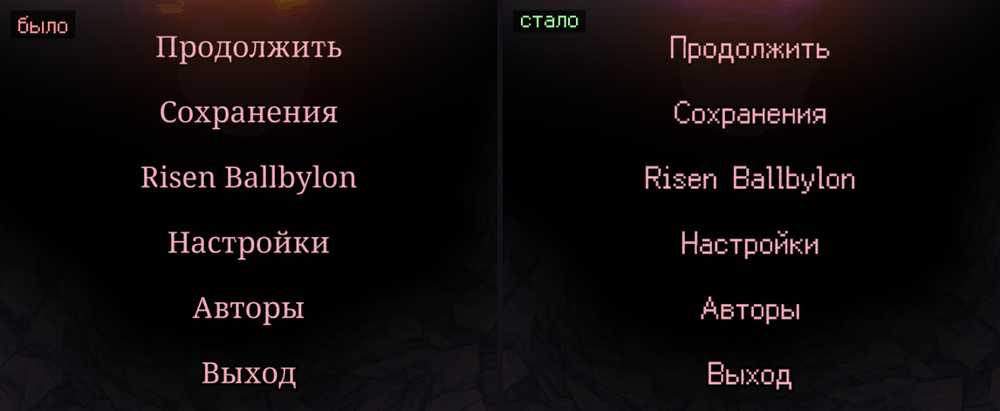
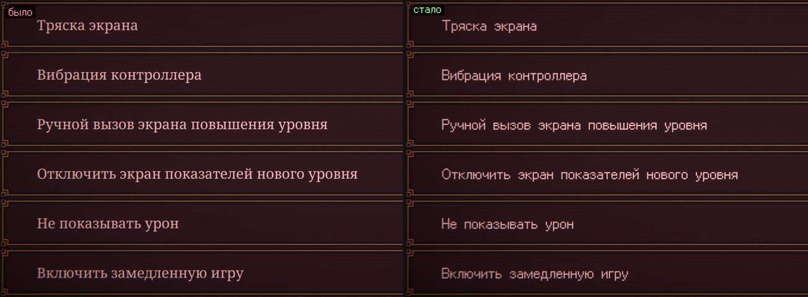

# BALL x PIT: пиксельный шрифт для русского

В английской версии игры пиксельные шрифты, но в них нет кириллицы, поэтому русский текст идёт обычным Noto Serif с засечками.
Мод меняет его на [Ark Pixel 12px](https://github.com/TakWolf/ark-pixel-font). Кириллица полная, есть Ё и украинские буквы.




## Установка

1. В [последнем релизе](../../releases/latest) скачай `BallxPit_RU_Font.zip` (не Source code) и распакуй.
2. Закрой игру и запусти `BallxPit_RU_Font.exe`, он сам найдёт игру. Если вылезет синее окно «Система Windows защитила ваш компьютер», нажми «Подробнее» и «Выполнить в любом случае».
3. Когда появится «Готово», нажми Enter. В настройках игры должен стоять русский язык.

Антивирус иногда удаляет exe сразу после распаковки. Тогда открой Безопасность Windows > Защита от вирусов и угроз > Журнал защиты и разреши файл.

Игра обновилась и шрифт пропал? Запусти exe ещё раз. Новая версия мода ставится так же, поверх старой.

## Удаление

`Uninstall.bat` из распакованной папки. Или в Steam: ПКМ по игре > Свойства > Установленные файлы > Проверить целостность файлов игры.

## Проблемы

Если программа пишет, что игра обновилась и шрифт устроен по-другому, она ничего не меняет в файлах. Создай issue здесь или напиши в комментариях к руководству в Steam.

## Для разработчиков

Патчер подменяет глифы и атлас шрифта `NotoSerif-Regular SDF` в `Balls_Data/resources.assets`, код игры не трогает.
`tools/build.py` собирает `data/` из TTF. Exe:

```
pip install UnityPy pyinstaller
pyinstaller --onefile --name BallxPit_RU_Font --add-data "data;data" --collect-all UnityPy --collect-all fmod_toolkit --collect-all texture2ddecoder --collect-all archspec ballxpit_ru_font.py
```

Шрифт Ark Pixel © TakWolf, лицензия SIL OFL 1.1 (`OFL-ArkPixel.txt`). Мод неофициальный.
